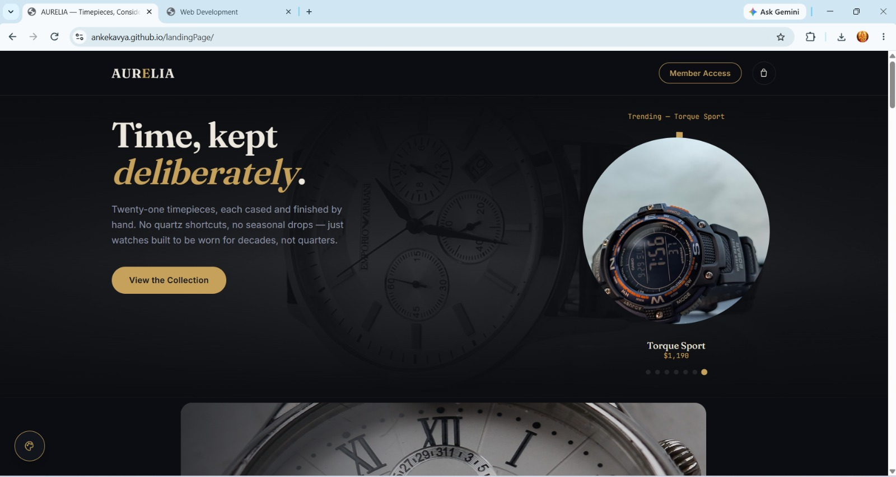
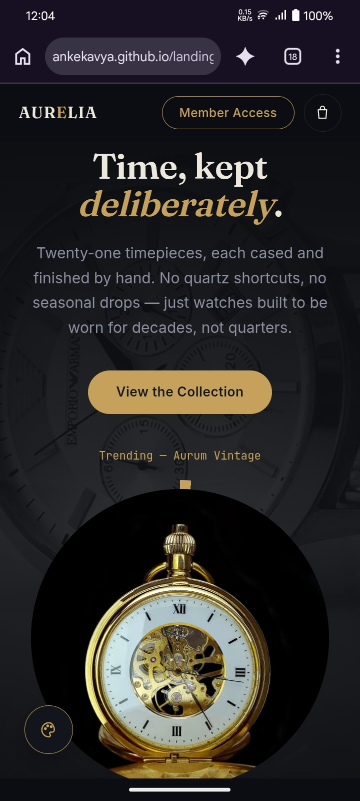

# AURELIA – Luxury Watch Collection

**Discover timeless elegance and premium craftsmanship.**

AURELIA is a luxury watch e-commerce website featuring an elegant black-and-gold design, premium watch collections, and a modern shopping experience.

## 🌐 Live Demo

[View Live Website](https://ankekavya.github.io/landingPage/)
## 📸 Website Screenshots

### Desktop View


### Mobile View


## ✨ Features

- Premium luxury watch collection
- Product category filtering
- Trending watches carousel
- Product details popup
- Shopping cart functionality
- User sign-in and sign-up
- Newsletter subscription
- Customizable website theme
- Responsive design

## 🛠️ Technologies Used

- HTML5
- CSS3
- JavaScript
- React.js

## 📂 Project Structure

```text
landingPage/
│
├── index.html
├── styles.css
├── app.js
└── README.md
```

## 🚀 How to Run Locally

1. Clone the repository:

```bash
git clone https://github.com/ankekavya/landingPage.git
```

2. Open the project folder.
3. Open `index.html` in your browser.

## 👩‍💻 Developer

**Kavya Sree Anke**

GitHub: [@ankekavya](https://github.com/ankekavya)

---

*Designed to bring timeless luxury to your everyday style.*
